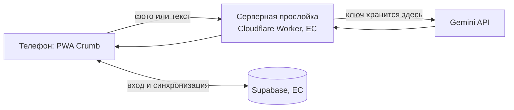

# Подключение Gemini

## Схема



Телефон никогда не обращается к Google напрямую и не хранит ключ. Поэтому пользователю не нужен VPN, а ключ нельзя вытащить из приложения.

## Что нужно, чтобы включить

1. **Ключ Gemini API.** Google AI Studio → Get API key → привязать платёжный аккаунт (платный уровень). Бесплатный уровень не подходит для реальных пользователей: Google может использовать присланные данные для улучшения продуктов, на платном уровне не использует.
2. **Секрет в хостинге, не в коде.** Ключ не попадает в репозиторий и в чат. Для Cloudflare:
   ```bash
   npx wrangler secret put GEMINI_API_KEY
   ```
   Команда сама спросит значение.
3. **Аккаунт Cloudflare** (бесплатный план) для Worker. Альтернатива: Vercel или Supabase Edge Functions.
4. **Проект Supabase** (регион ЕС) для входа и синхронизации. Нужны URL проекта и публичный `anon key`; они публичные, их можно хранить в коде.

## Модель

По [странице цен Gemini API](https://ai.google.dev/gemini-api/docs/pricing) на платном уровне (за 1 млн токенов, вход текст и изображение / выход):

| Модель | Вход | Выход | Заметка |
|---|---|---|---|
| `gemini-3.1-flash-lite` | $0.25 | $1.50 | Самая дешёвая стабильная из доступных новым ключам, стартуем с неё |
| `gemini-3.5-flash-lite` | $0.30 | $2.50 | Новее и точнее, сравниваем на тесте |
| `gemini-3.8-flash` | см. страницу | см. страницу | Резерв для случаев с низкой уверенностью |

Модели 2.5 в документации помечены как доступные только прежним пользователям. Идентификаторы и цены меняются, сверять со страницей перед релизом.

Оценка стоимости одного снимка: около 1 500 входных и 400 выходных токенов, то есть 0,1–0,15 цента. Это прикидка, не измерение. Токены размышления модели тоже тарифицируются, поэтому ограничиваем их.

Выбор делаем по тесту: 10–30 блюд с известным весом, сравнить ошибку калорий и стоимость.

## Контракт серверной прослойки

`POST /api/estimate`

```json
{ "lang": "ru", "text": "латте с двумя ложками сахара", "image": "<base64 jpeg, до 4 МБ, или null>", "restrictions": ["lactose"] }
```

Ответ (то же, что сейчас ждёт прототип):

```json
{ "title": "Латте с сиропом",
  "items": [{ "name": "Латте, 300 мл", "grams": 300, "kcal": 150, "p": 8, "f": 7, "c": 13, "sugar": 12, "fiber": 0 }],
  "confidence": 0.72,
  "note": "Сироп даёт почти треть калорий напитка.",
  "questions": [{ "q": "Какой сироп?", "options": ["Обычный", "Без сахара"] }] }
```

Запрос к Gemini (REST):

- `POST https://generativelanguage.googleapis.com/v1beta/models/<model>:generateContent`
- заголовок `x-goog-api-key: <секрет>`
- `contents[0].parts`: текст с правилами оценки + при фото `inline_data { mime_type, data }`
- `generationConfig.responseMimeType = "application/json"` и `responseSchema` под ответ выше

Правила оценки (скрытые калории, мелочи отдельными позициями, не больше 2 вопросов, язык ответа) уже написаны в `app/index.html`, функция `foodRules()`. Переносим их в Worker без изменений.

Поправка пользователя («без сыра, съел половину») идёт тем же эндпоинтом с полем `previous` (прошлая оценка) и `fix`.

## Лимиты и защита

- Бесплатно 3 ИИ-фото в день на пользователя, счётчик на сервере по id из Supabase.
- Размер изображения и частота запросов ограничены, анонимные запросы не принимаются.
- Фото не сохраняется: приходит, уходит в Gemini, ответ возвращается.
- CORS только для нашего домена.

## Порядок работ

1. Worker с `/api/estimate`, локальный запуск через `wrangler dev` с тестовым ключом в `.dev.vars` (файл в `.gitignore`).
2. Тест точности на 10–30 взвешенных блюдах, выбор модели.
3. В `app/index.html` заменить вызовы Claude (`SAMPLE.json`) на `fetch('/api/estimate')`.
4. Вход через Supabase и лимит 3 фото в день.
5. Коуч через тот же Worker (`/api/coach`) с тем же строгим промптом.
